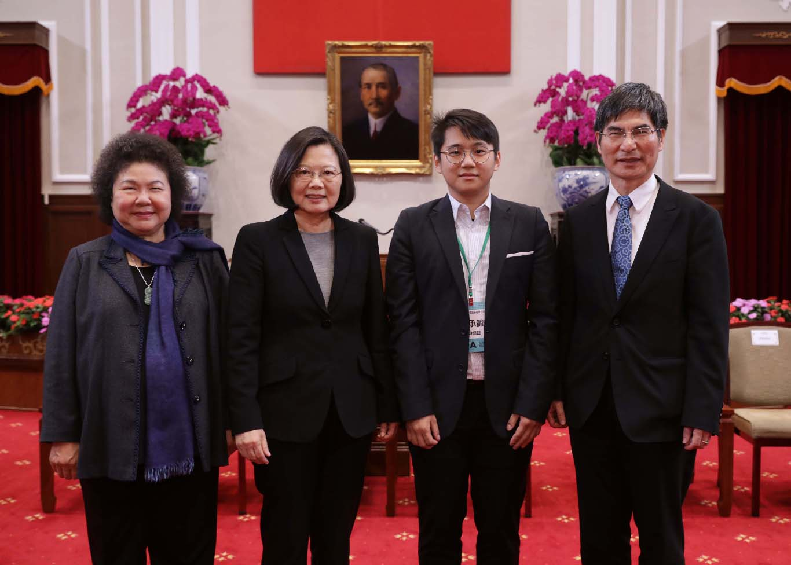

I am a Ph.D. student in Electrical Engineering at **National Taiwan University (NTU)**. My research interests include signal processing, biomedical instrumentation, radar sensing, and wireless sensing systems.

My previous research has focused on physiological signal processing and sensor design, particularly **cuffless blood pressure estimation**, photoplethysmography (PPG), pulse wave velocity (PWV), and hemodynamic modeling. More recently, my research interests have expanded to radar-based physiological sensing and adaptive signal processing.

I have authored and co-authored more than ten peer-reviewed journal articles, including multiple first-author and corresponding-author publications. My work emphasizes integrating theoretical modeling, signal processing algorithms, and experimental sensing systems.

## Research Interests

- Statistical and Adaptive Signal Processing
- Biomedical Signal Processing and Physiological Sensing
- Radar and Wireless Sensing Systems
- Sensor Fusion and Measurement Systems

[The president **Tsai Ing-wen** met with national representatives from CES 2019 at the Presidential Office](https://www.taiwannews.com.tw/en/news/3646420).

(Secretary-General to the President, **Chen Chu**., The President, **Tsai Ing-wen**., **Me**., The Minister of MOST of Taiwan, **Chen Liang-Gee**)
